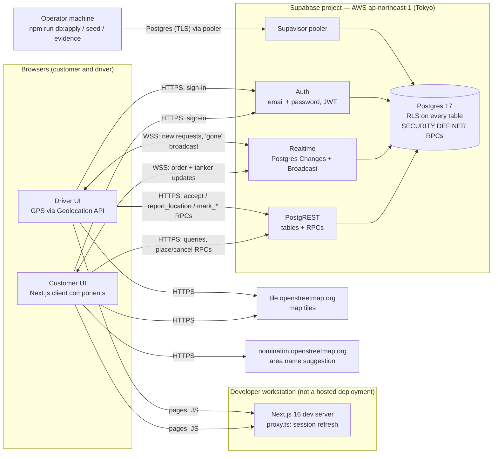

# Architecture — Nama tanker MVP

This page describes what is actually running today. The section at the end describes a possible target set-up for Oman; **none of it is implemented**.

## Current deployment (as of this commit)

- **Application:** Next.js 16 (App Router, TypeScript), run with `npm run dev` on a developer workstation. It is **not deployed** to Vercel or any other host: the repository has no Vercel project link or deployment configuration, and no git remote.
- **Backend:** one Supabase project (managed cloud) in AWS region **`ap-northeast-1` (Tokyo)**, providing Postgres 17, Auth (email + password), PostgREST and Realtime. The region was read from the project's connection-pooler host.
- **Third-party services called from the browser:** OpenStreetMap's public tile server (map tiles) and OSM Nominatim (suggesting the area name from the pin). Both are community services with usage policies, suitable for a demo only.
- **Not in place:** no CDN or WAF of our own, no custom domain, no backups beyond the Supabase plan defaults, no disaster recovery, no monitoring or alerting, no payment gateway, no NWS system integrations.

### Where the controls live

| Concern | Mechanism | Evidence |
|---|---|---|
| Who sees which rows | Postgres Row Level Security on `profiles`, `tankers`, `orders`, `order_locations` | `supabase/migrations/0001_init.sql`; the AUTHZ section of [test-report.md](test-report.md) |
| Order state changes | Only through `SECURITY DEFINER` RPCs; clients have no INSERT/UPDATE grants on `orders` | the AUTHZ and LIFE sections |
| One driver per job | Conditional `UPDATE … WHERE status = 'requested'`, plus a partial unique index for one active job per driver | the RACE section |
| Prices | Computed in the database, never accepted from the client | the PRICE and AUTHZ sections |
| Order numbers | Sequence + insert trigger, immutable after insert | the ONUM and MIG sections |
| Exact address | Separate `order_locations` table, visible to the assigned driver only while the job is active | the AUTHZ section |
| GPS freshness | `last_seen_at` stored server-side; `location_stale` computed field (60 s) | the GPS section |
| Secrets | Publishable key in the browser; service-role key used only by `scripts/seed.ts` and the test runner | `.env.local.example` |

## Target for Oman (not yet implemented)

Nothing in this section exists today. It lists what would have to be decided and built before the platform could serve NWS in production. Each item depends on NWS requirements and the tender's terms, and needs confirming.

- **Data residency and hosting:** where customer, driver and location data must be stored and processed (in-country or approved region), and which hosting options satisfy that. The current Supabase region (Tokyo) is a demo choice, not a proposal.
- **Application hosting:** a production host for Next.js in the chosen region, with a custom domain, TLS, CDN and WAF.
- **Database:** a managed or self-hosted Postgres in the chosen region, with point-in-time recovery, tested backup restores, and separate staging and production.
- **Disaster recovery:** recovery objectives (RPO/RTO) agreed with NWS, and a secondary site or region, with failover tested. Not designed yet.
- **Maps and routing:** a tile provider and geocoder with a commercial licence or a self-hosted stack, plus a self-hosted routing service. Replaces the public OSM services used in the demo.
- **Integrations:** filling-station/TAS, IVMS, payment gateway, call centre, BI and ROP interfaces, all pending interface specifications from NWS.
- **Identity:** SMS/OTP sign-in and civil ID verification as required by NWS; staff single sign-on.
- **Operations:** monitoring, alerting, audit-log retention, incident runbooks and an SLA definition.
- **Compliance:** any applicable Omani data-protection, cybersecurity and procurement requirements. Not assessed; no compliance is claimed.
